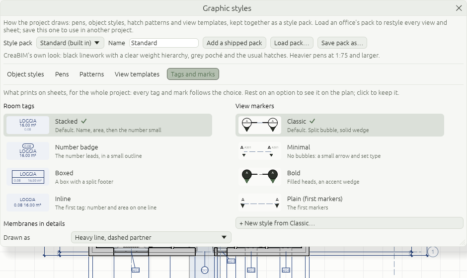
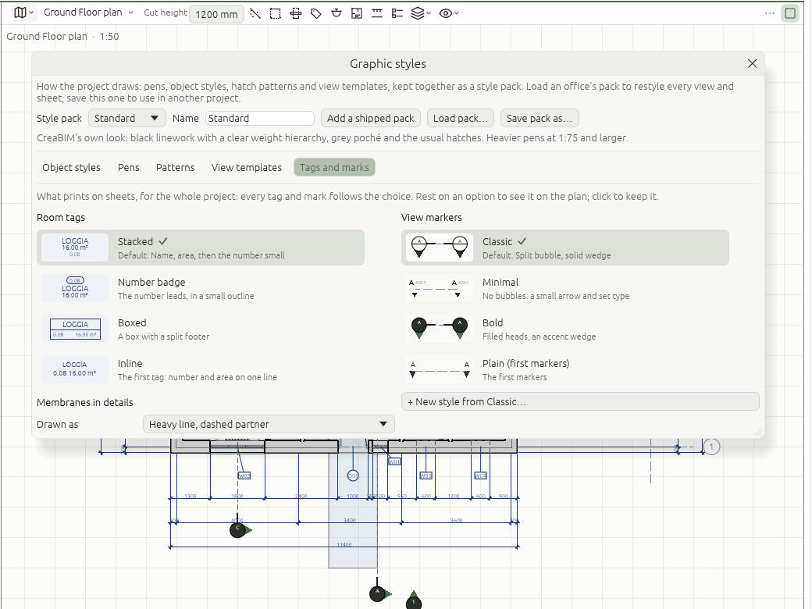
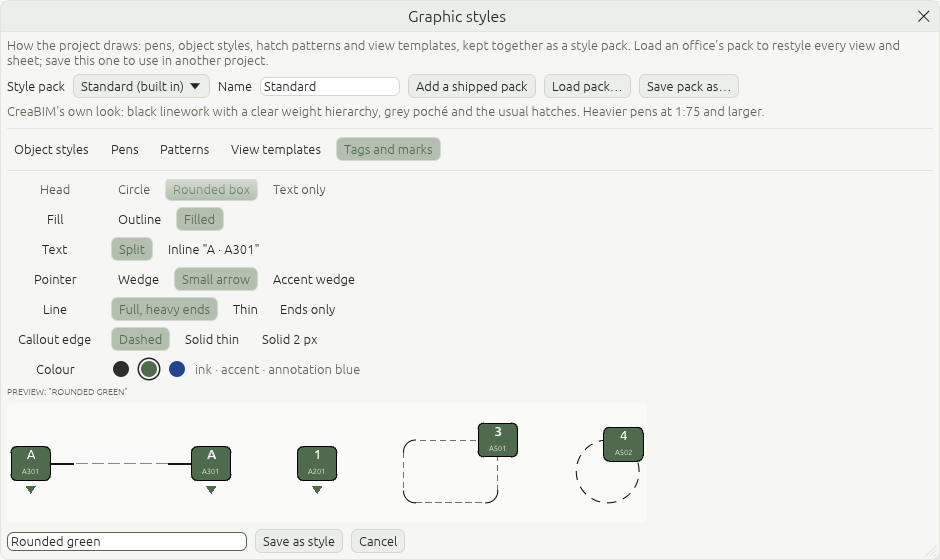
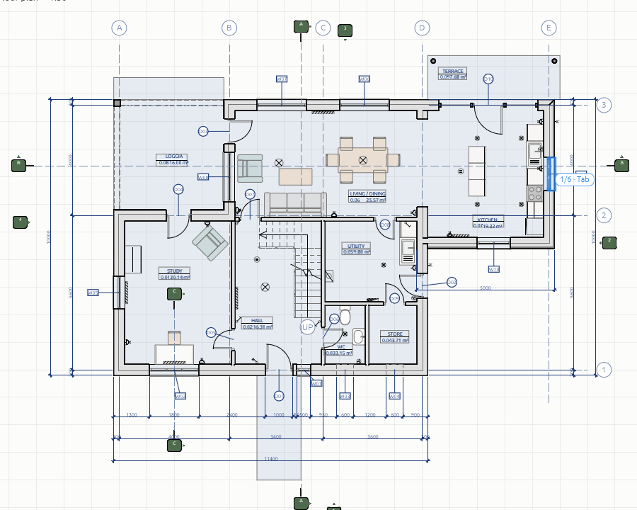
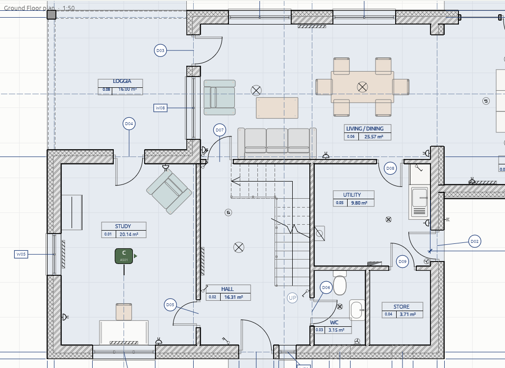
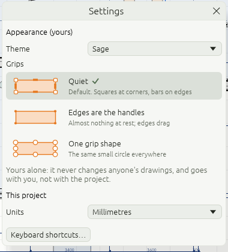
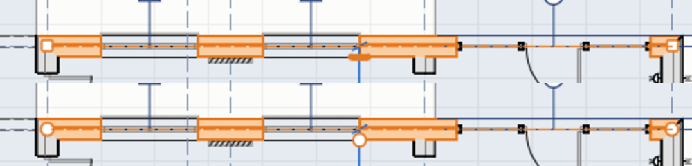
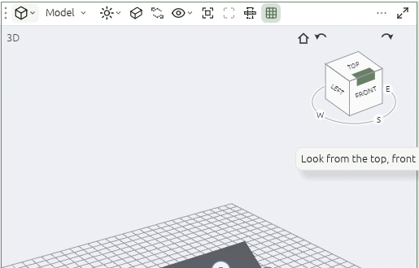
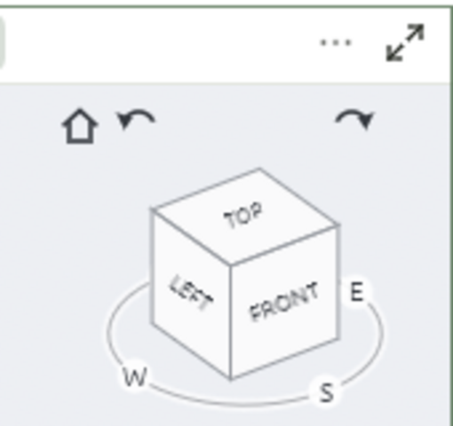
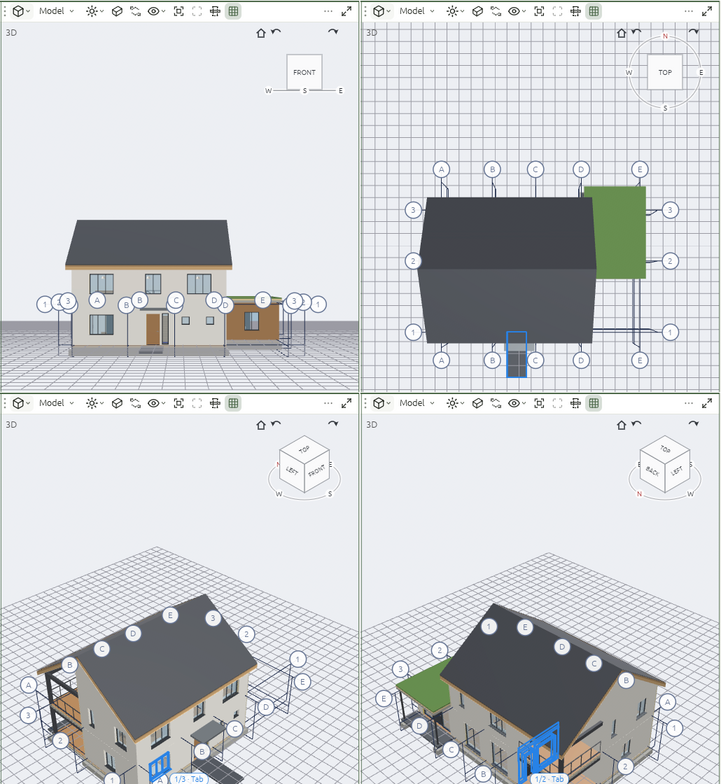

# Brief 02, Phase 3: structure

Reference screenshots for Phase 3 of *CreaBIM brief 02: consolidated* (2026-11-04). They were taken in the running app on the starter house (`creabim sample house.creabim`, then `creabim-app house.creabim`). Items move from [docs/KNOWN_GAPS.md](../../KNOWN_GAPS.md#brief-02-2026-11-04) to its *Recently fixed* list as they land.

## Item by item

| Brief | What | Status |
| --- | --- | --- |
| 3.1 (2.6) | View areas and workspaces | **Done, with small gaps** (below). |
| 3.2 (2.10, part 3) | Temporary dimensions that drive, with the padlock | **Done in plans, with gaps** (below). |
| 3.3 (2.11–2.13) | Choices with pictures, personal settings, style packs, the marker and tag designer, style pack export and import | **Partly done** (below): pictures, live preview and the marker designer are in; the tag designer is not. |
| 3.4 (4.2) | View cube | **Done, with small gaps** (below). |

## 3.1 View areas and workspaces

The middle of the window is now a set of **view areas**. Each area shows the 3D view, a view (plan, section, elevation, detail, schedule) or a sheet, and has its own header:

- the kind pill (3D, plan, section…) picks what the area shows, and the name next to it picks the view;
- the view's own controls follow: for 3D the render style, perspective, crop boxes, visibility, framing, X-ray and so on; for a plan its tags, underlay, visibility and cut height;
- on the right, *Show this area alone* and a ⋯ menu.

When an area is too narrow, the controls that don't fit go into its ⋯ menu, with *Split side by side*, *Split one above the other*, *Close this area* and *Show this area alone*. The 3D view's floating toolbar and the view controls in the options row are gone.

**Workspaces** are named layouts of areas, in the top-right menu and under *View → Workspace*:

| Workspace | Areas |
| --- | --- |
| Model | the 3D view alone |
| Drawing | 3D beside the current drawing |
| Document | 3D beside the current drawing, with its sheet under it |
| Sheets | the sheet that holds the current drawing, beside the drawing |

*The current drawing* is the plan or section you were last working in, so switching workspace keeps you on it. *Save current layout…* keeps your own layout under a name, and it can be deleted from the same menu.

**Keys:** Ctrl+Space shows the area under the pointer alone, and again brings the others back. Ctrl+PgUp and Ctrl+PgDn step through the workspaces. `/` isolates the selection, or shows everything again if anything is hidden.

**Splitting and joining:** drag an area's corner grip (the three dots at the left of its header) into the same area to split it there, or into the area beside it to join them. While dragging, the new half is tinted, or the area that would close is. The strips between areas resize them, and a double-click evens them out.

**The hint line** for where the pointer is (for example *Click to select, Shift+click to add…*) now sits in the status bar after the message, in grey, instead of over the plan.

### Still to do in 3.1

- Saved workspaces live in your user settings, not in the project, so they follow you from project to project but not to another computer.
- Only one area can show the 3D view at a time.
- A number control (such as *Cut height*) that doesn't fit an area header has no place in its ⋯ menu yet; it comes back when the area is wider.
- A sheet has no *Open in area ▾* yet; a double-click on a sheet's view opens it in place.
- A corner join always closes the area dragged into.

## 3.2 Temporary dimensions that drive

Select one wall, grid line, door, window or column in a plan. Blue dimensions show its distance to its nearest neighbours:

| Selected | Measures to |
| --- | --- |
| Grid line | the parallel grid lines on each side |
| Wall | the parallel walls on each side that run beside it, and grid lines |
| Door or window | the wall's ends, or the next opening in the same wall, on each side |
| Column | the nearest grid line or wall, and the nearest one running the other way |

**Click a value and type** a new one, then Enter: the element moves to make it true. A wall takes its doors and windows and the walls joined to it along. A grid line takes the walls and columns standing on it. Tab moves on to the next value, Backspace takes a character back, Esc stops. The status bar says what changed, for example *Moved Grid B −400 mm: 4000 mm → 3600 mm from grid A. Ctrl+Z to undo.* It is the same typing as the tracker.

**The padlock** beside a value keeps it as a dimension that holds the spacing. Moving either end, by any means (a drag, Move, Align, a typed value), then moves the other by as much, square to it, in the same undo step. What moves can set off other held spacings further on. Click a closed padlock to let the spacing go; the dimension stays as a plain one. Typing a new value into a held spacing holds the new value.

### Still to do in 3.2

- Levels: their temporary dimensions in sections and elevations are not done yet (a level's height can be typed in the Levels window).
- Walls are measured centreline to centreline; there is no choice of faces or core yet.
- A door or window measures to its wall's centreline end, not to the face of the wall it meets.
- Only walls and columns exactly on a grid line go with it. In the starter house some walls sit a little off their grid line, so moving that grid can open a gap at a corner, and rooms then run together until the walls are moved to meet again.
- The padlock is drawn in the plan, not from the icon set; it needs the owner's look at it.
- Lockable pairs are grid lines, walls and columns; a door's gaps can be typed but not locked.
- The new value doesn't fade in after Enter.

## 3.3 Choices with pictures, and your own styles

*Graphic styles › Tags and marks* no longer offers two drop-down lists. Every choice is a row with a small picture of what it draws, a name and one line on what it is. **Rest the pointer on a row and the drawings show it straight away**; move off and they go back; click to keep it. A preview is never an undo step.

**Room tags** come in four layouts, all drawn now: *Stacked* (the default: name, area, then the number small), *Number badge* (the number in a small outline on top), *Boxed* (a box with the name, and a footer split between number and area) and *Inline* (the first tag).

**View markers** come in four families, all drawn now: *Classic* (split bubble, solid wedge), *Minimal* (no bubble, a small arrow and set type), *Bold* (filled heads, an accent wedge) and *Plain* (the first markers). They change section marks, elevation marks and callouts together.

**The marker designer** (*+ New style from …*) mixes a marker from its parts: head (circle, rounded box, text only), fill (outline, filled), text (split, or inline *A · A301*), pointer (wedge, small arrow, accent wedge), line (full with heavy ends, thin, ends only), callout edge (dashed, solid thin, solid 2 px) and colour (ink, the accent, annotation blue). A preview of a section, an elevation, a rectangular and a round callout follows each change. *Save as style* adds it under **Your styles**, with *Edit…* and *Delete*, and the project draws with it.

**Your own styles belong to the style pack.** *Save pack as…* writes them into the pack file and *Load pack…* brings them into another project, so an office's markers travel with its pack.

**Personal settings stay yours.** *Settings* keeps *Appearance (yours)*, now with the theme and the **grip style**, apart from *This project*. Grips come as *Quiet* (the default: squares at corners, bars on edges), *Edges are the handles* (almost nothing at rest; an edge shows its bar under the pointer and drags) or *One grip shape* (the same small circle everywhere). Resting on one previews it on the selection; the choice goes with you, not with the project, and never changes anyone's drawings.

### Still to do in 3.3

- There is no room tag designer yet: the four layouts are presets.
- Pictures and live previews are in *Tags and marks* and the grip choice only; pens, patterns, object styles and view templates are still plain lists.
- A marker's colour applies to its fills and text; its lines stay ink.
- Zoomed far out on screen, text is drawn at least 7 px high, so a Boxed tag's footer can run into its divider; on paper it fits.
- The grip accent colour is not a personal setting yet.

## 3.3 How to test

1. *Manage › Graphic styles › Tags and marks*. Rest the pointer on *Bold*: the plan's marks turn bold. Move off: they go back, and Ctrl+Z has nothing new to undo.
2. Click *Boxed* under Room tags: every room tag in the plan becomes a box.
3. *+ New style from Classic…*: pick Rounded box, Filled, Small arrow and the green swatch, name it and *Save as style*. It shows under *Your styles* and on the plan.
4. *Save pack as…*, open another project and *Load pack…*: the style comes along.
5. *CreaBIM › Settings…*, select a wall, rest on *One grip shape*, then click it. Restart: it is still your choice.

## 3.4 View cube

The 3D view has a **view cube** in its top right corner.

- **26 hot zones.** Each face, edge and corner lights up under the pointer, with a tip such as *Look from the top, front (south)*. A click turns the view there smoothly, in about a third of a second, by the shorter way round. The status bar then says *Looking from the top, front, left (south-west).*
- **Compass ring.** N, E, S and W sit on a ring on the ground under the cube; a click looks from that side. N is red. Letters behind the cube are hidden by it.
- **Quarter-turn arrows.** The two arrows above turn the view 90° round the vertical. From a corner view they go to the next corner.
- **Home.** The house frames everything from the three-quarter view.
- **Dragging** the cube orbits the view.
- **Faces are named from north.** North is up in plans (+Y). *Front* is the south face, so *Front* shows the building as its south elevation does, and *Top* keeps north up.

### Still to do in 3.4

- North is the model's +Y; the project has no true-north angle yet, so the faces can't follow a site turned off the axes.
- The cube can't be hidden, resized or moved, and has no right-click menu (such as *Set this view as home* or *Orthographic on faces*).
- Picking a face keeps perspective on; it doesn't switch to orthographic.
- There is a cube only in the 3D view, not in sections or elevations.

## 3.4 How to test

1. Open the starter house. Rest the pointer on the cube's *Front*; it lights up with a tip. Click it: the view turns to the south side.
2. Click *Top*: the plan from above, north up. Click the house to go back.
3. Click the corner where *Top*, *Left* and *Front* meet, then the right-hand arrow: the view goes from the south-west corner to the north-west one.
4. Click *S* on the ring, then drag the cube to orbit.

## How to test 3.2

1. Select grid B in the ground floor plan. Click its value to grid A, type `3600` and press Enter. Grid B moves, and the wall on it goes with it. Ctrl+Z puts it back.
2. Select a wall and type a spacing to the wall beside it; joined walls stretch to stay joined.
3. Select grid B again and click the padlock beside the A–B value. Select grid A and drag it: grid B follows.
4. Click the closed padlock to let it go, and drag grid A again: B stays.

## How to test 3.1

1. Open the starter house. The Drawing workspace shows 3D beside the ground floor plan.
2. Pick *Document* and then *Sheets* from the top-right menu; each keeps the same plan and shows its sheet.
3. Rest the pointer on the plan and press Ctrl+Space; press it again.
4. Press Ctrl+PgDn a few times, then Ctrl+PgUp.
5. Select a wall and press `/`; press `/` again.
6. Drag the plan's corner grip down inside the plan and let go; then drag the new area's grip into the one above it.
7. Narrow the plan area by dragging the strip between it and the 3D view, and open its ⋯ menu.
8. *Save current layout…*, name it, switch away and back to it.
