# Brief 02, Phase 4: heavy modelling

Reference screenshots for Phase 4 of *CreaBIM brief 02: consolidated* (2026-11-04), as the owner amended it on 2026-11-05. The items come one at a time, in this order:

1. layer editing in plan, section, 3D and any other useful view, such as callouts;
2. drawing on any face, with align, mirror, offset, move, rotate and the other manipulations there;
3. edge offset in 3D and 2D;
4. take-off;
5. image and PDF references;
6. profiles;
7. curved walls.

Items move from [docs/KNOWN_GAPS.md](../../KNOWN_GAPS.md#brief-02-2026-11-04) to its *Recently fixed* list as they land.

The screenshots were taken in the running app on a small L corner cut out of the starter house: two 400 mm walls of *Exterior wall 400, rendered* (render 20, mineral wool 150, block 215, plaster 15), 1.5 m each, with the plan and the 3D view side by side.

## Item by item

| Item | Part | Status |
| --- | --- | --- |
| 1 (3.7) | Wall layer ends: grips in Layers, drag or type, a dot on edited ends, reset one or all, kept through move, stretch and retype | **Done** (below). |
| 1 (3.7) | Slab and roof layer edges: a grip on each edge of each layer, drag or type, reset | **Done** (below). |
| 1 (3.7) | Corner join presets: Auto, Cores lap and finishes stop, This or the other wall runs through, Mitre every layer, Not joined | **Done** (below). |
| 1 (3.7) | *Draw by this line* on any layer boundary | Not started. |
| 1 (3.7) | Check model warnings for gaps and overlaps; IFC parts where layers differ | Not started. |
| 2–7 | | Not started. |

## 1. Layer editing

### Wall layer ends

Select a layered wall, press `Enter` for Edit mode, then `Tab`: **Layers**. Its own grips give way to one grip at each end of each layer, where its join puts that end. `Tab` again goes back to the wall's grips, and leaving Edit mode leaves Layers too.

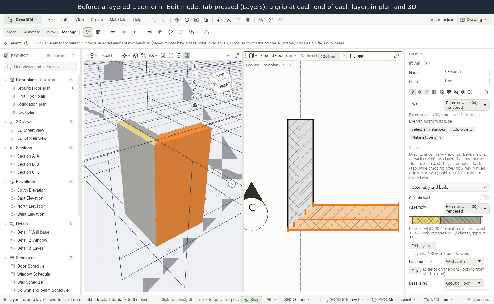

The grip under the pointer names its layer and end ("Block, concrete: end"), and once moved, by how much.

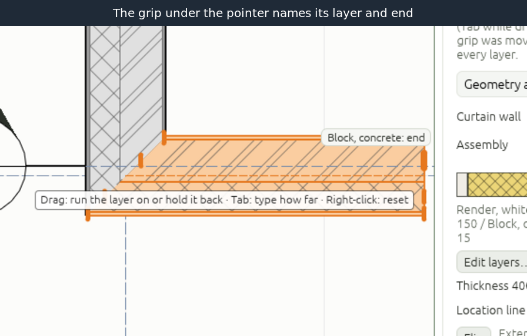

Drag a grip along the wall to run the layer on past its join, or to hold it back. While dragging, `Tab` (or a digit) types the distance, as with every grip; `Enter` applies it.

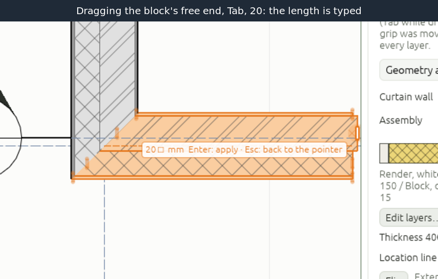

After the drag, the moved end's grip is filled. Here the block runs 20 mm past the wall's free end, and the plaster is held back 50 mm from the corner. Plans, sections, callouts and 3D all draw the layers from the same pieces, so they all follow:

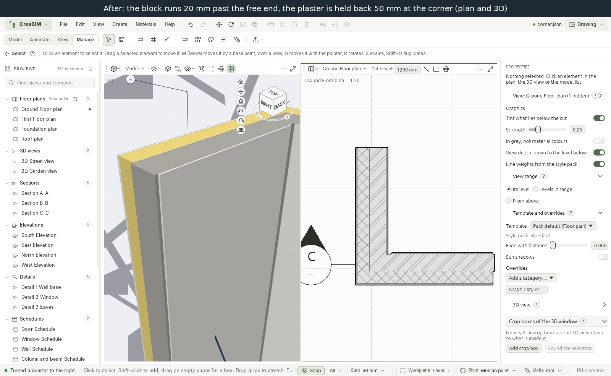

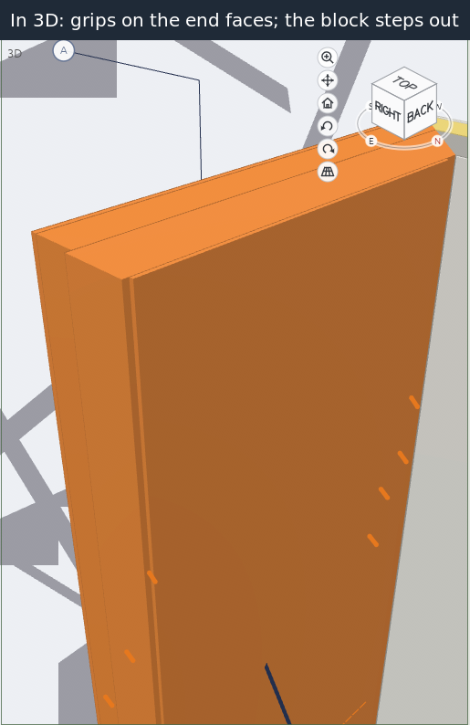

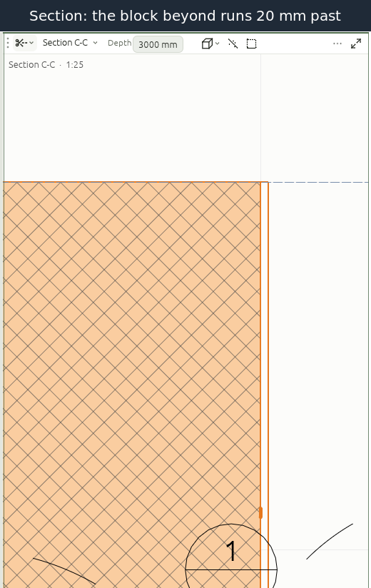

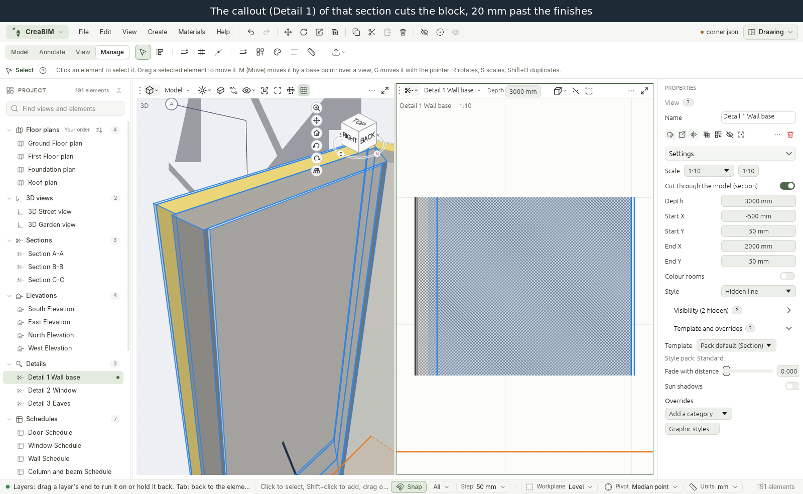

**How it is kept.** Each edit is an offset from where the join puts that layer's end, stored on the wall (`layer_ends` in the file, left out when there are none). So it stays through a move, a stretch, a slide, and a change of the other wall. Changing the wall's type keeps the edits of layers the new type also has; the others are dropped, and the status bar says how many.

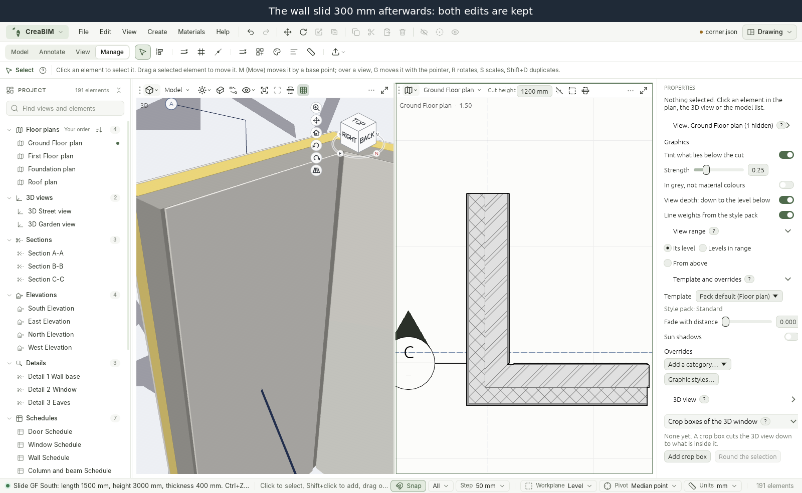

**Reset.** Right-click a layer grip: *Reset layer end* puts that end back on its join, *Reset all layers* every end of the wall. Each is one undo step.

### Slab and roof layer edges

On a layered slab or roof, `Tab` in Edit mode shows a grip on each edge of each layer, at the middle of the edge and of the layer's depth. Drag one square to the edge, or type how far, to push that layer out past the element's edge or pull it in: a slate run on past the fascia, insulation stopped short of a slab edge. A roof's edges are its eaves and verges, and a pushed-out layer runs on down its own slope. In plan, where a slab's layers sit on one another, each layer's grip is drawn a step further out; in sections and 3D each is at its own depth.

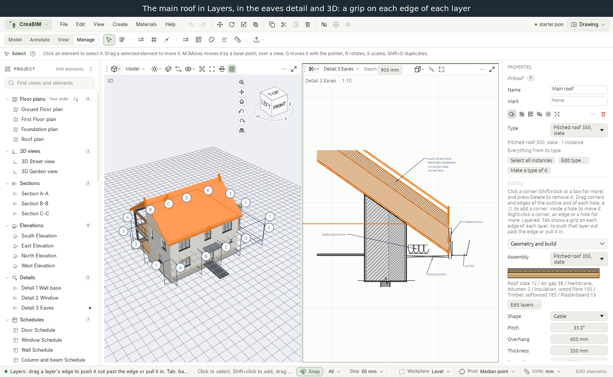

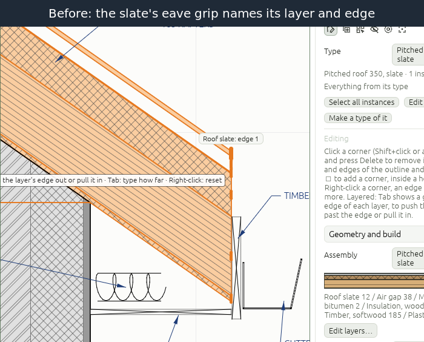

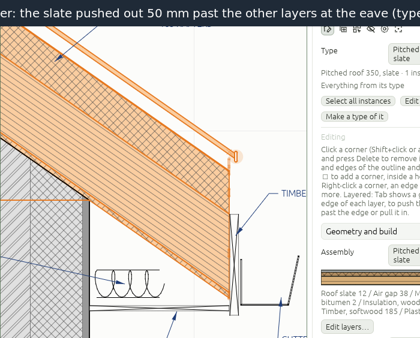

Each edit is kept on the slab or roof (`layer_edges` in the file) as a distance square to that edge, so it moves with the edge when the outline is reshaped. *Reset layer edge* and *Reset all layers* are in the grip's right-click menu, and a change of type drops the edits of layers the new type lacks, as for walls.

**Gaps still open** (in [KNOWN_GAPS](../../KNOWN_GAPS.md)):

- A slab's arc edge is moved by its corners, so its bulge keeps its ratio rather than staying parallel.
- Adding or removing a corner of the outline renumbers its edges, and edits on edges after it move to the next edge.

- A layer run on by hand into the wall it meets overlaps that wall's layers, and the plan draws one over the other.
- While a grip is dragged, the preview is drawn without the joins of the walls around it.
- Grips of thin layers sit close together in plan at small scales: zoom in, or use the 3D view, where they are stepped up the end face.
